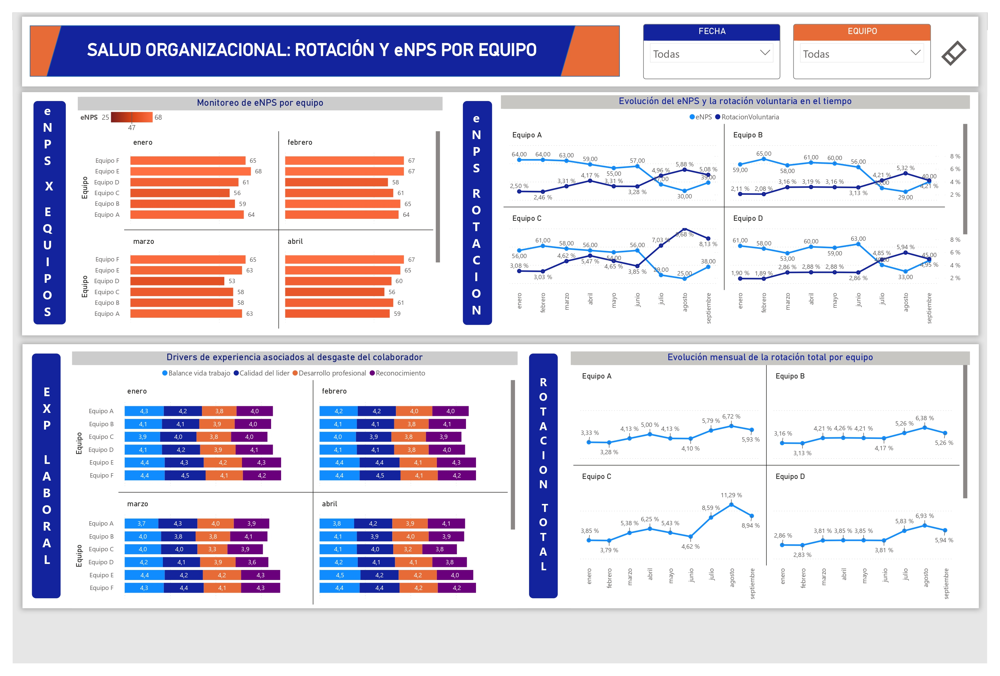

# 📊 People Analytics | Rotación y eNPS

### Dashboard de Salud Organizacional y Priorización de Equipos


**Periodo analizado:** Enero – Septiembre 2025  
**Alcance:** 6 equipos organizacionales  
**Herramientas:** Power BI Desktop y Microsoft Excel

---

## 📌 Descripción del proyecto

Este proyecto presenta un dashboard de **People Analytics desarrollado en Power BI**, orientado al análisis de la rotación de colaboradores, el Employee Net Promoter Score (eNPS) y los factores asociados a la experiencia laboral.

El objetivo es transformar datos de recursos humanos en información que facilite la identificación de equipos con indicadores críticos y permita formular recomendaciones para la gestión del talento.

El análisis comprende seis equipos organizacionales durante nueve meses, de enero a septiembre de 2025.

## 🎯 Problema de negocio

En un escenario de gestión de recursos humanos, los líderes identifican señales de desgaste laboral, pérdida de talento clave y deterioro del ambiente organizacional.

Ante esta situación, surge la necesidad de responder cuatro preguntas:

- ¿Cómo ha evolucionado la rotación de colaboradores?
- ¿Qué equipos presentan los niveles más bajos de eNPS?
- ¿Qué factores de experiencia laboral coinciden con el deterioro de los indicadores?
- ¿Qué equipos deberían priorizarse considerando su criticidad y el esfuerzo estimado de intervención?

El propósito no es únicamente visualizar indicadores, sino **facilitar decisiones de gestión respaldadas por datos**.

---

## 📈 Vista previa del dashboard



### 🔗 Dashboard interactivo

El reporte permite explorar los indicadores mediante filtros por equipo y periodo.

**[▶️ Explorar dashboard en Power BI](https://app.powerbi.com/view?r=eyJrIjoiN2JlOGYzOTEtYzIzMS00OGI1LWFmNjEtMDkyZWY3M2Q1YTI4IiwidCI6IjMyMDliNTBiLWI3OWItNDNkYy05ZmM0LThkNDJjNDA2ZGQ2MSIsImMiOjR9)**

---

## 🎯 Objetivos del análisis

### Objetivo general

Desarrollar un dashboard de People Analytics que permita analizar indicadores de rotación y experiencia laboral, facilitando la identificación y priorización de equipos que requieren atención.

### Objetivos específicos

- Analizar la evolución de la rotación voluntaria y total.
- Evaluar el eNPS de los seis equipos.
- Identificar cambios relevantes en los indicadores de experiencia laboral.
- Comparar las tendencias de rotación, eNPS y factores organizacionales.
- Proponer acciones de mejora considerando criticidad y esfuerzo estimado.

---

## 📊 Indicadores clave (KPIs)

| Indicador | Descripción |
|-----------|-------------|
| Rotación voluntaria | Salidas voluntarias respecto al promedio mensual de colaboradores. |
| Rotación total | Salidas voluntarias e involuntarias respecto al promedio mensual de colaboradores. |
| eNPS | Diferencia entre el porcentaje de promotores y detractores. |
| Balance vida-trabajo | Evaluación de la percepción del equilibrio entre responsabilidades laborales y personales. |
| Calidad del líder | Evaluación de la percepción del liderazgo. |
| Reconocimiento | Evaluación de la percepción del reconocimiento laboral. |
| Desarrollo profesional | Evaluación de las oportunidades de crecimiento profesional. |

### Fórmulas principales

**Rotación voluntaria**

`Rotación voluntaria = Salidas voluntarias / Colaboradores promedio`

**Rotación total**

`Rotación total = (Salidas voluntarias + Salidas involuntarias) / Colaboradores promedio`

**Employee Net Promoter Score**

`eNPS = % Promotores - % Detractores`

El eNPS se expresa en puntos, dentro de una escala de -100 a 100.

Las medidas DAX y las reglas de agregación utilizadas en el modelo quedan pendientes de documentación técnica.

---

## 🛠️ Herramientas utilizadas

| Herramienta | Aplicación |
|-------------|------------|
| Power BI Desktop | Desarrollo del modelo y las visualizaciones del dashboard. |
| Microsoft Excel | Fuente de información del ejercicio. |

## 🗂️ Fuentes de datos

El ejercicio utiliza dos hojas de Excel, con 54 registros mensuales por hoja, correspondientes a seis equipos durante nueve meses.

### 1. Rotación_Mensual

Contiene información mensual por equipo:

- Colaboradores promedio.
- Ingresos.
- Salidas voluntarias.
- Salidas involuntarias.

### 2. Experiencia_Drivers

Contiene información sobre:

- Porcentaje de promotores, pasivos y detractores.
- Balance vida-trabajo.
- Calidad del líder.
- Reconocimiento.
- Desarrollo profesional.

Los cuatro factores de experiencia laboral se evalúan en una escala de 1 a 5.

> **Confidencialidad:** Este trabajo parte de un ejercicio de evaluación técnica. Los datos originales y archivos que contengan información de uso interno no deben distribuirse públicamente sin autorización. Para una publicación abierta, se requiere utilizar material autorizado o una versión con datos sintéticos.

---

## 🔄 Proceso de análisis

```text
Datos de Excel
      │
      ▼
Importación a Power BI
      │
      ▼
Preparación y organización de datos
      │
      ▼
Modelo de datos y medidas
      │
      ▼
Construcción de indicadores
      │
      ▼
Visualización de tendencias
      │
      ▼
Comparación entre equipos
      │
      ▼
Hallazgos y priorización
      │
      ▼
Propuestas de intervención
```

El proceso se orientó a comparar la evolución de los indicadores y formular recomendaciones a partir de los patrones observados.

---

# 💡 Principales hallazgos

## 1. Deterioro del eNPS desde julio de 2025

Durante el periodo de enero a junio, los seis equipos mantuvieron indicadores de eNPS relativamente estables, con valores comprendidos entre **53 y 68 puntos**.

Sin embargo, desde julio se identificaron deterioros en cuatro equipos: **A, B, C y D**.

Estos cambios coincidieron con disminuciones en diferentes factores de experiencia laboral.

La coincidencia temporal permite identificar señales que requieren investigación, aunque no demuestra por sí sola una relación causal.

## 2. Comparación de indicadores por equipo

La siguiente tabla resume los resultados reportados para enero y septiembre de 2025.

| Equipo | Principal factor deteriorado | eNPS enero → septiembre | Rotación total septiembre |
|--------|-----------------------------|-------------------------|---------------------------|
| A | Balance vida-trabajo | 64 → 39 | 5.93% |
| B | Calidad del líder | 59 → 40 | 5.26% |
| C | Desarrollo profesional y liderazgo | 56 → 38 | 8.94% |
| D | Reconocimiento | 61 → 45 | 5.94% |
| E | Sin deterioro relevante identificado | 68 → 64 | 4.30% |
| F | Sin deterioro relevante identificado | 65 → 68 | 2.38% |

### Interpretación

**Equipo A — Balance vida-trabajo**

El eNPS disminuyó de 64 a 39 puntos, mientras que el indicador de balance vida-trabajo pasó de 4.3 a 2.3.

Este resultado sugiere investigar posibles cambios en la carga laboral, horarios y condiciones de trabajo.

**Equipo B — Calidad del liderazgo**

El eNPS pasó de 59 a 40 puntos y la evaluación del liderazgo disminuyó de 4.1 a 2.2.

Se identifica una oportunidad para profundizar en las condiciones de liderazgo y la experiencia de los colaboradores.

**Equipo C — Desarrollo profesional y liderazgo**

Presentó el eNPS más bajo en septiembre (38 puntos) y la mayor rotación total del periodo analizado para ese mes (8.94%).

Adicionalmente, se observaron deterioros en desarrollo profesional (3.8 a 1.8) y calidad del liderazgo (4.0 a 2.6).

Estos resultados convierten al Equipo C en un caso de especial atención.

**Equipo D — Reconocimiento**

El eNPS disminuyó de 61 a 45 puntos y la percepción del reconocimiento pasó de 4.1 a 2.2.

El reconocimiento constituye el principal factor identificado para investigar en este equipo.

**Equipos E y F — Comportamiento relativamente estable**

Ambos equipos presentaron indicadores más favorables en comparación con los equipos afectados.

El Equipo F registró una rotación total de 2.38% en septiembre y un incremento del eNPS de 65 a 68 puntos.

---

## 3. El Equipo C presenta la situación más crítica

Entre los seis equipos, el Equipo C destaca por la combinación de tres señales:

- **8.94% de rotación total en septiembre**, la más alta entre los equipos.
- **38 puntos de eNPS**, el valor más bajo registrado en septiembre.
- Deterioro simultáneo en desarrollo profesional y liderazgo.

A diferencia de otros equipos, donde se identifica principalmente un factor deteriorado, el Equipo C presenta dos dimensiones afectadas.

Por ello, se recomienda considerar una intervención integral y un seguimiento prioritario.

---

# 🎯 Matriz de priorización

El análisis propone clasificar a los equipos considerando dos dimensiones:

**Criticidad:** gravedad de los indicadores observados, especialmente eNPS, rotación y deterioro de la experiencia laboral.

**Esfuerzo estimado:** complejidad inicial de intervención, aproximada mediante la cantidad de factores deteriorados.

La clasificación es cualitativa y debe validarse con Recursos Humanos.

| Equipo | Criticidad | Esfuerzo estimado | Prioridad propuesta |
|--------|------------|-------------------|---------------------|
| A | Alta | Bajo | Intervención focalizada |
| D | Alta | Bajo | Intervención focalizada |
| B | Alta | Bajo | Siguiente intervención |
| C | Muy alta | Alto | Atención urgente en paralelo |
| E | Baja | Bajo | Seguimiento |
| F | Baja | Bajo | Seguimiento |

### Interpretación de la priorización

Los **equipos A y D** se proponen como primeras intervenciones focalizadas, debido a que presentan deterioros relevantes concentrados en un factor de experiencia laboral.

El **Equipo B** representa una siguiente oportunidad de intervención, enfocada en la calidad del liderazgo.

Por su parte, el **Equipo C requiere atención urgente en paralelo**, debido a su elevada criticidad, aunque la intervención podría demandar mayores recursos.

Esta priorización constituye una propuesta analítica, no una estimación validada de costos o tiempos.

---

# 🚀 Recomendaciones y planes de acción

Las siguientes acciones son propuestas del ejercicio. No representan intervenciones ejecutadas ni resultados comprobados.

### Equipo A — Balance vida-trabajo

**Objetivo:** investigar y mejorar las condiciones asociadas al equilibrio laboral.

Acciones propuestas:

- Evaluar la carga laboral y las horas extra.
- Revisar la distribución de responsabilidades.
- Analizar alternativas de flexibilidad laboral.

**Meta propuesta:** recuperar la evaluación del factor a 4.0 o más, sujeta a validación.

### Equipo D — Reconocimiento

**Objetivo:** fortalecer las prácticas de reconocimiento.

Acciones propuestas:

- Revisar los mecanismos actuales de reconocimiento.
- Promover prácticas de reconocimiento entre colaboradores.
- Evaluar la frecuencia de retroalimentación de los líderes.

**Meta propuesta:** recuperar el indicador a 3.8 o más, sujeta a validación.

### Equipo B — Calidad del liderazgo

**Objetivo:** identificar oportunidades de mejora en la experiencia de liderazgo.

Acciones propuestas:

- Realizar entrevistas y sesiones de retroalimentación.
- Evaluar posibles cambios en la estructura del equipo.
- Proponer acompañamiento y desarrollo de liderazgo.

### Equipo C — Desarrollo profesional y liderazgo

**Objetivo:** atender de manera integral los indicadores críticos.

Acciones propuestas:

- Evaluar las oportunidades de crecimiento profesional.
- Revisar las prácticas de liderazgo.
- Investigar los principales motivos de salida.
- Establecer un seguimiento periódico de los indicadores.

**Prioridad:** atención urgente y coordinada con Recursos Humanos.

---

## 🔎 Información adicional recomendada

Para profundizar en el análisis y validar las hipótesis identificadas, sería conveniente incorporar:

| Información adicional | Utilidad |
|-----------------------|----------|
| Motivos de salida | Identificar factores asociados a la rotación. |
| Horas extra y carga laboral | Investigar posibles problemas de balance vida-trabajo. |
| Cambios de liderazgo | Analizar eventos organizacionales relacionados con los cambios de percepción. |
| Antigüedad y nivel del colaborador | Identificar segmentos con mayor riesgo de salida. |
| Evaluaciones de desempeño | Analizar la relación entre desarrollo profesional y retención. |
| Información salarial comparativa | Evaluar posibles diferencias de competitividad salarial. |

Estos datos permitirían complementar el análisis descriptivo y mejorar la calidad de las recomendaciones.

---

## 📚 Resultados y aprendizajes

El ejercicio permitió desarrollar una propuesta analítica que integra indicadores de rotación, experiencia laboral y priorización de equipos.

### Principales aprendizajes

**Análisis de indicadores**

Interpretar métricas de recursos humanos considerando su evolución temporal y las diferencias entre equipos.

**Visualización de datos**

Organizar indicadores en un dashboard que facilite la exploración y comparación de resultados.

**Pensamiento analítico**

Identificar patrones, formular hipótesis y reconocer las limitaciones de los datos disponibles.

**Orientación al negocio**

Transformar los resultados del análisis en recomendaciones y criterios de priorización para apoyar decisiones.

### Limitaciones del análisis

- Los patrones observados no permiten establecer relaciones causales.
- El esfuerzo de intervención se estimó cualitativamente.
- No se dispone de evidencia de ejecución de las acciones propuestas.
- Queda pendiente documentar las medidas DAX exactas y las reglas de agregación del modelo.

---

## 📁 Estructura del repositorio

```text
people-analytics-powerbi-dashboard/
│
├── README.md
│
├── images/
│   └── dashboard_preview.jpg
│
├── powerbi/
│   └── salud_organizacional.pbix
│
└── datos/
    └── datos.xlsx
```

Los archivos de datos y Power BI deben publicarse únicamente cuando exista autorización para compartir su contenido.

---

## 👨‍💻 Autor

**Erick Jauregui**

Estudiante de Ingeniería de Sistemas de Información, con interés en Análisis de Datos, Business Intelligence y visualización de información.

🌐 **Portafolio personal:** [jaureguierick.netlify.app](https://jaureguierick.netlify.app/)

📊 **Caso de estudio:** [People Analytics — Rotación y eNPS](https://jaureguierick.netlify.app/proyecto-people-analytics)

---

⭐ *Proyecto desarrollado como ejercicio aplicado de People Analytics, orientado a transformar indicadores de recursos humanos en recomendaciones para la toma de decisiones.*
